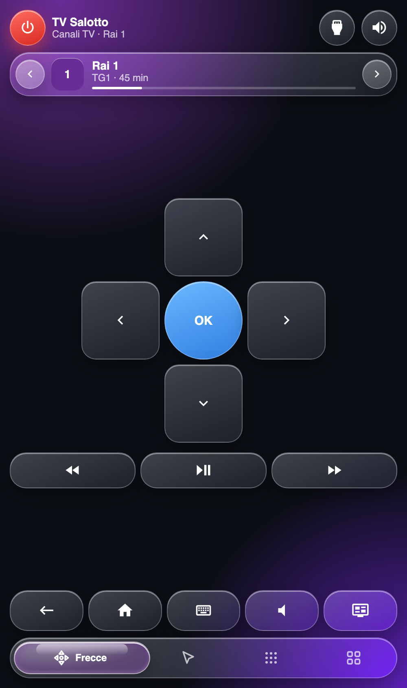
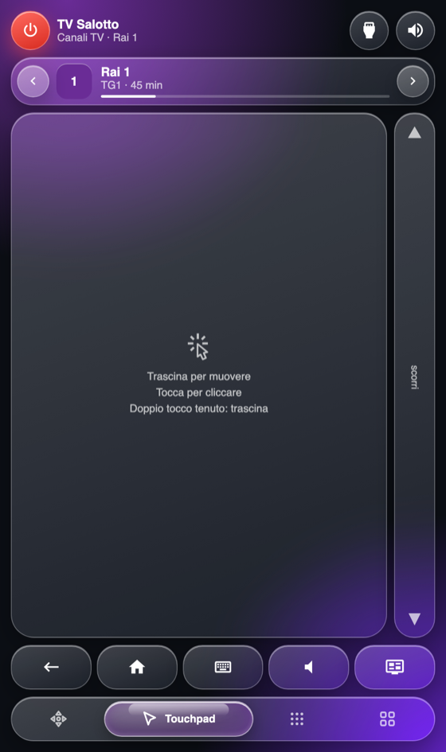
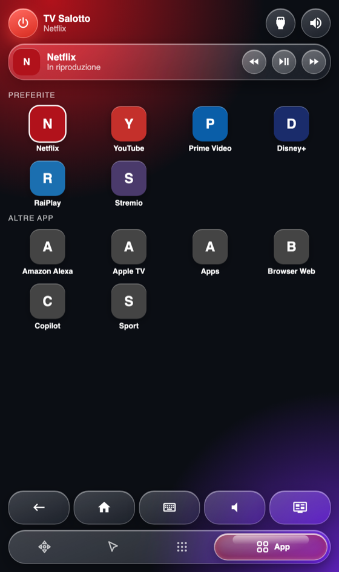
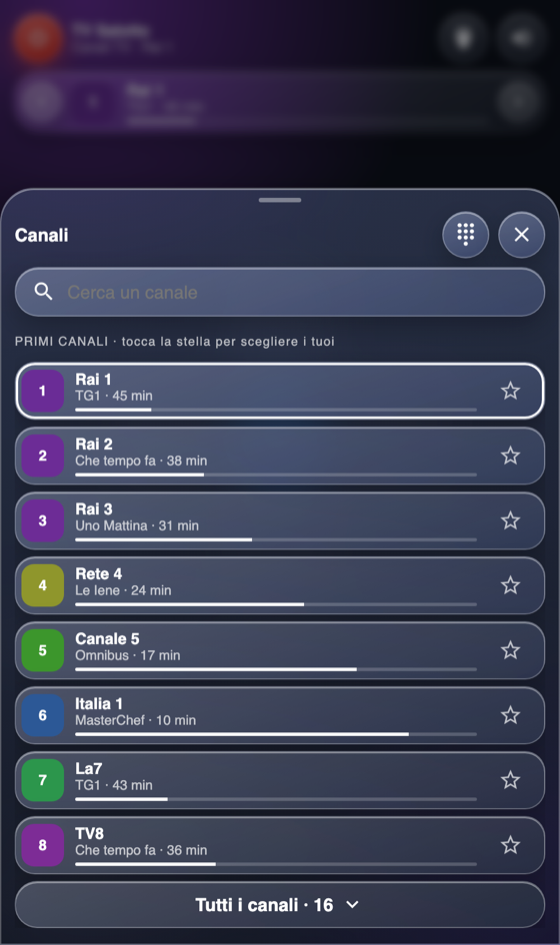
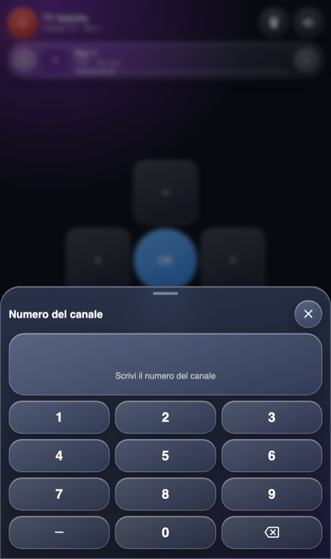
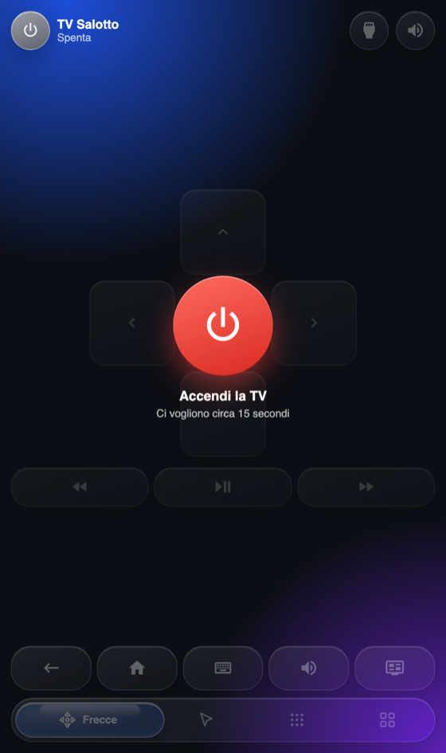

# lg-tv-remote-card

[English](README.md) · **Italiano**

Card Lovelace che trasforma lo smartphone nel telecomando di una TV LG webOS, basata sull'integrazione
`webostv` di Home Assistant. Interfaccia in italiano.

<p align="center">
  
  
  
</p>
<p align="center">
  
  
  
</p>

## Funzioni

- Look «liquid glass»; lo sfondo prende il colore del canale o dell'app in corso
- Accensione (rossa, si spegne tenendo premuto un secondo) e muto; volume e canale si aprono dal dock come controlli di vetro che si espandono (trascini la pillola del volume, oppure usi −/+; canale su/giù con il tastierino e l'elenco a un tocco); la striscia di scorrimento sta nella tab touchpad
- Barra «in onda»: canale e programma con i minuti rimasti e canale precedente/successivo; nelle app mostra l'app e indietro / play-pausa / avanti
- Foglio dei canali (tocchi la barra): preferiti con il programma, ricerca, tutti i canali, stella per fissarli
- Foglio del numero: digiti il canale e parte 1,8 s dopo l'ultima cifra (un anello mostra l'attesa, tocchi il display per andare subito)
- Foglio ingressi e app (icona in alto): ingressi HDMI, app preferite con le icone originali della TV
- Touchpad con vero puntatore sulla TV (tocco = clic, doppio tocco e tieni premuto = trascina, striscia laterale = scorri)
- Tab frecce, tab tasti (cifre, menu, info, esci, tasti colorati), tab app, tastiera a comparsa (testo in tempo reale, dettatura)
- Scorrimento tra le tab con uno swipe, stati chiari per «TV spenta», «accensione» e comandi falliti

## Struttura

```
src/constants.js          ogni numero regolabile e ogni elenco statico
src/logic.js              funzioni pure (niente DOM, niente Home Assistant), con test
src/channels.js           funzioni pure sui canali (programma in onda, preferiti, numero digitato)
src/tv-data.js            legge dalla TV elenco canali, programma e icone delle app (con cache del browser)
src/channels-view.js      markup dell'elenco canali
src/styles.js             CSS (liquid glass; --tint viene dalla sorgente in corso)
src/template.js           markup; gli attributi data-* sono il contratto con la classe della card
src/gestures.js           gestori del tocco, ognuno collegato a un piccolo oggetto `host`
src/apps-view.js          la tab «App»
src/lg-tv-remote-card.js  punto d'ingresso: I/O con Home Assistant, collegamenti e stato
test/*.test.mjs           `npm test`: test unitari ed end-to-end della card su una TV finta
test/support/mock-tv.mjs  una TV LG e un Home Assistant finti (servizi, canali, programmi, ritardi di accensione e spegnimento, errori)
test/support/dom.mjs      configura jsdom e monta la card vera sulla TV finta
test/harness.html         pagina di prova visiva con una TV finta (vedi sotto)
test/serve.py             server statico senza cache per la pagina di prova
deploy.sh                 pubblica in /config/www come versione immutabile
demo/mock/                `node demo/mock/build.mjs` crea una pagina HTML: la card vera sulla TV finta, con un pannello per spegnere la TV, aprire un campo di testo, far fallire un comando
```

## Configurazione della card

```yaml
type: custom:lg-tv-remote-card
entity: media_player.lg_tv   # predefinito
name: TV Salotto
favorites: [Netflix, YouTube, Prime Video, Disney+, RaiPlay, Stremio]   # app mostrate per prime
favorite_channels: ['1', '2', '3']   # numeri dei canali in cima; la stella nel foglio vale per dispositivo e li sostituisce
hidden: [Developer Mode, Memory Care, OfficeViewer, FlexIt]   # nascoste da «Altre app»
scroll_gain: 2
scroll_invert: false         # invertilo se la striscia laterale scorre al contrario
haptics: soft                # off | soft | normal | strong (Android e app HA; iOS lo ignora)
auto_open_keyboard: true     # apre il foglio di testo quando la TV mette a fuoco un campo
```

È pensata per una vista di tipo `panel`, così riempie lo schermo. Le stesse opzioni sono nell'editor visivo della card
(impostazioni della card nell'editor della dashboard).

## Canali, programmi e icone

La card legge l'elenco canali e il programma in onda con `webostv.command` (`tv/getChannelList`,
`tv/getChannelProgramInfo`), che restituisce i dati a chi lo chiama. La riga del programma compare solo quando
l'elenco programmi della TV copre l'ora attuale. Le icone delle app arrivano dal servizio `lgtv_pointer.app_icons`,
che le copia in `/config/www/lg-tv-remote/icons/` perché la TV le serve in HTTPS con un certificato autofirmato.
Senza il componente le app restano una lettera colorata.

## Supporto al puntatore (facoltativo)

`webostv` espone solo i tasti del telecomando. Il puntatore del touchpad, l'apertura automatica della tastiera e le
icone delle app richiedono la piccola integrazione [lgtv-pointer](https://github.com/mrgiov/lgtv-pointer),
installabile con HACS (categoria Integrazione). Senza, il touchpad ripiega su swipe = frecce e tocco = OK.

## Apertura automatica del foglio tastiera

Attiva di default (`auto_open_keyboard: false` la disattiva). La card chiede a `lgtv_pointer.watch_keyboard`
di iscriversi a `com.webos.service.ime/registerRemoteKeyboard` e apre il foglio sugli eventi
`lgtv_pointer_keyboard`. La TV risponde solo quando un campo di testo ha il focus, perciò il componente
invia l'iscrizione senza aspettare una prima risposta. Su iOS la tastiera del telefono può richiedere comunque un tocco.

## Installazione con HACS

1. HACS → ⋮ → Repository personalizzati → aggiungi questo repository, categoria **Dashboard**.
2. Installa **LG TV Remote Card**; HACS registra la risorsa da solo.
3. Aggiungi la card: `type: custom:lg-tv-remote-card`.

L'integrazione facoltativa [lgtv-pointer](https://github.com/mrgiov/lgtv-pointer) (puntatore del touchpad, tastiera automatica, icone delle app) si installa a parte, sempre con HACS.

## Sviluppo e pubblicazione

```bash
npm test                                   # test unitari
npm run build                              # riunisce src/ in dist/lg-tv-remote-card.js (il file che serve HACS; va committato)
python3 test/serve.py                      # server senza cache; apri localhost:8767/test/harness.html#on (anche #off, #unavailable, #on,apps, #live,dpad,channels)
./deploy.sh                                # stampa l'URL della risorsa
```

Punta la risorsa della dashboard (tipo `module`) all'URL stampato da `deploy.sh`. Ogni pubblicazione è una
cartella nuova, quindi non serve svuotare la cache: basta ricaricare la dashboard.

## Licenza

MIT
