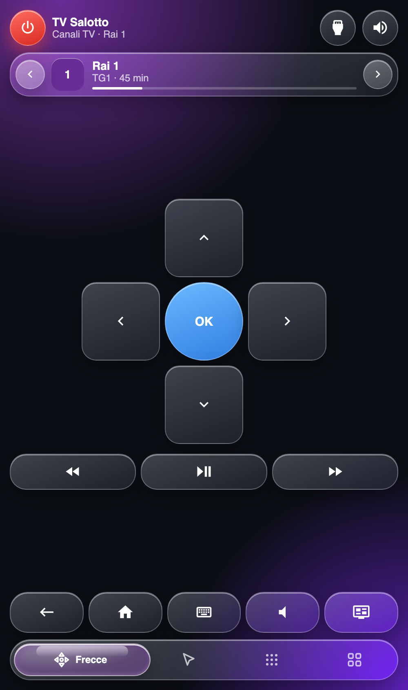

# lg-tv-remote-card

Lovelace card that turns a phone into a remote for an LG webOS TV, built on the core
`webostv` integration. Italian UI.

<p align="center"></p>

## Features

- Liquid-glass look; the background takes the colour of the current channel or app
- Power (red, hold one second to switch off), mute; volume and channel open from the dock as expanding glass controls (drag the volume pill, or use −/+; channel up/down with the number pad and the list one tap away); the scroll strip sits on the touchpad tab
- "Now playing" strip: channel and programme with minutes left and prev/next channel; in apps it shows the app and rewind / play-pause / forward
- Channels sheet (tap the strip): favourites with programme, search, all channels, star to pin
- Number sheet: type a channel number; the channel starts 1.8 s after the last digit (a ring shows the wait, tap the display to go now)
- Inputs and apps sheet (header icon): HDMI inputs, favourite apps with the TV's own icons
- Touchpad with a real TV pointer (tap = click, double-tap and hold = drag, side strip = scroll)
- D-pad tab, keys tab (digits, menu, info, exit, colour keys), apps tab, keyboard bottom sheet (live text, dictation)
- Swipe between tabs, clear states for "TV off", "waking" and failed commands

## Layout

```
src/constants.js          every tunable number and static list
src/logic.js              pure functions (no DOM, no Home Assistant), unit tested
src/channels.js           pure channel helpers (programme on air, favourites, number entry)
src/tv-data.js            reads channel list, programme and app icons from the TV (with a browser cache)
src/channels-view.js      channel list markup
src/styles.js             CSS (liquid glass; --tint comes from the current source)
src/template.js           markup; data-* attributes are the contract with the card class
src/gestures.js           touch handlers, each wired to a small `host` object
src/apps-view.js          the "App" tab
src/lg-tv-remote-card.js  entry point: Home Assistant I/O, wiring and state
test/*.test.mjs           `npm test`: unit tests plus end-to-end tests of the card against a mock TV
test/support/mock-tv.mjs  a fake LG TV and Home Assistant (services, channel list, programmes, wake and sleep delays, failures)
test/support/dom.mjs      jsdom setup that mounts the real card on the mock TV
test/harness.html         visual test page with a fake TV (see below)
test/serve.py             static server without caching for the harness
deploy.sh                 publishes to /config/www as an immutable version
demo/mock/                `node demo/mock/build.mjs` builds one HTML page: the real card on the mock TV, with a panel to switch the TV off, open a text field, make a command fail
```

## Card configuration

```yaml
type: custom:lg-tv-remote-card
entity: media_player.lg_tv   # default
name: TV Salotto
favorites: [Netflix, YouTube, Prime Video, Disney+, RaiPlay, Stremio]   # apps shown first
favorite_channels: ['1', '2', '3']   # channel numbers listed first; the star in the sheet overrides this per device
hidden: [Developer Mode, Memory Care, OfficeViewer, FlexIt]   # kept out of "Altre app"
scroll_gain: 2
scroll_invert: false         # flip if the side strip scrolls the wrong way
haptics: soft                # off | soft | normal | strong (Android and the HA app; iOS ignores it)
auto_open_keyboard: true     # open the text sheet when the TV focuses a field
```

It is meant for a `panel` view so it fills the screen. The same options are in the card's visual editor
(card settings in the dashboard editor).

## Channels, programmes and icons

The card reads the channel list and the programme on air with `webostv.command` (`tv/getChannelList`,
`tv/getChannelProgramInfo`), which returns data to the caller. The programme line is shown only when the TV's
programme list covers the current time. App icons come from the `lgtv_pointer.app_icons` service, which copies
them into `/config/www/lg-tv-remote/icons/` because the TV serves them over HTTPS with a self-signed certificate.
Without the component the app tiles keep a coloured letter.

## Pointer support (optional)

`webostv` only exposes remote buttons. The touchpad pointer, the keyboard auto-open and the app icons need the small
companion integration [lgtv-pointer](https://github.com/mrgiov/lgtv-pointer), installable with HACS (category
Integration). Without it the touchpad falls back to swipe-as-arrows and tap-as-OK.

## Auto-opening the keyboard sheet

On by default (`auto_open_keyboard: false` turns it off). The card asks `lgtv_pointer.watch_keyboard`
to subscribe to `com.webos.service.ime/registerRemoteKeyboard` and opens the sheet on
`lgtv_pointer_keyboard` events. The TV only replies once a text field has focus, so the component
sends the subscription without waiting for a first reply. On iOS the phone keyboard may still need a tap.

## Install with HACS

1. HACS → ⋮ → Custom repositories → add this repository, category **Dashboard**.
2. Install **LG TV Remote Card**; HACS registers the resource itself.
3. Add the card: `type: custom:lg-tv-remote-card`.

The optional [lgtv-pointer](https://github.com/mrgiov/lgtv-pointer) integration (touchpad pointer, keyboard auto-open, app icons) is installed separately, also with HACS.

## Develop and deploy

```bash
npm test                                   # unit tests
npm run build                              # bundles src/ into dist/lg-tv-remote-card.js (the file HACS serves; commit it)
python3 test/serve.py                      # no-cache server; open localhost:8767/test/harness.html#on (also #off, #unavailable, #on,apps)
./deploy.sh                                # prints the resource URL
```

Point the dashboard resource (type `module`) at the URL `deploy.sh` prints. Every deploy is a
new folder, so no cache clearing is needed beyond reloading the dashboard.

## License

MIT
